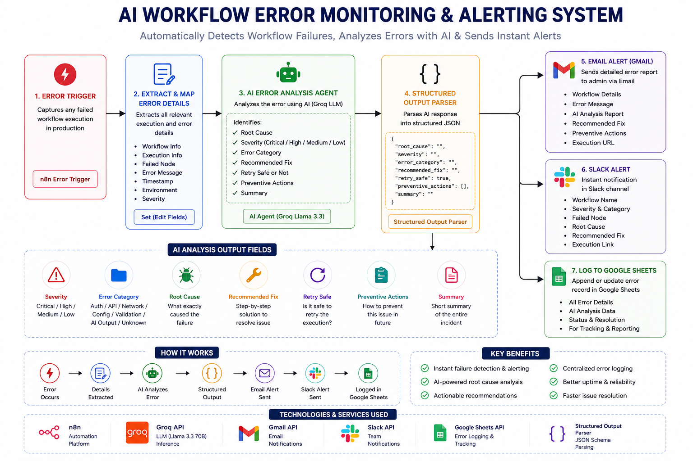
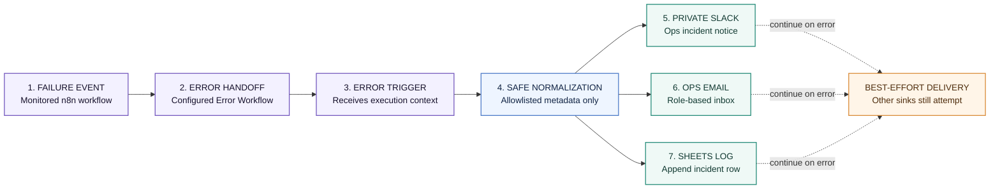

# Privacy-Aware n8n Failure Alerting — Architecture

**End-to-end incident notification flow: capture minimal failure metadata and fan it out to operations channels without copying raw payloads or stack traces.**

## 1. Workflow at a glance

## 2. Safe incident payload

| Included operational metadata | Deliberately excluded |
|---|---|
| Timestamp, workflow/execution IDs, failed node, execution mode, error class/name, retry reference, failed status | Raw error message, stack trace, trigger payload, business/customer data, internal execution URL |

Identifiers and node names can still reveal internal operations. Keep all destinations and n8n execution history access-controlled.

## 3. Destinations and behavior

- **Slack:** private operations channel.
- **Gmail:** configured operations inbox.
- **Google Sheets:** append-only incident log.
- Each sink is best-effort/continue-on-error; one destination failing should not intentionally block the others. This does not guarantee delivery if n8n or all sinks are unavailable.

## 4. Services used

`n8n Error Trigger` · `Slack` · `Gmail` · `Google Sheets`.

## 5. Deployment notes

Import the sanitized workflow, bind least-privilege credentials, configure private destinations, and assign it as the Error Workflow for monitored n8n workflows. Test a controlled failure and each sink failure separately. Set independent retention/access controls for n8n's own execution logs; this flow does not change them.

> **Portfolio output:** this is an internal Error Workflow, not a public webhook service. Use an independent uptime monitor for cases where n8n itself is unavailable.
